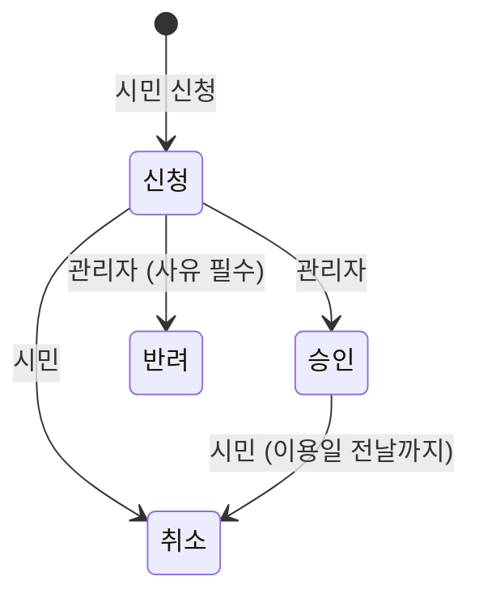
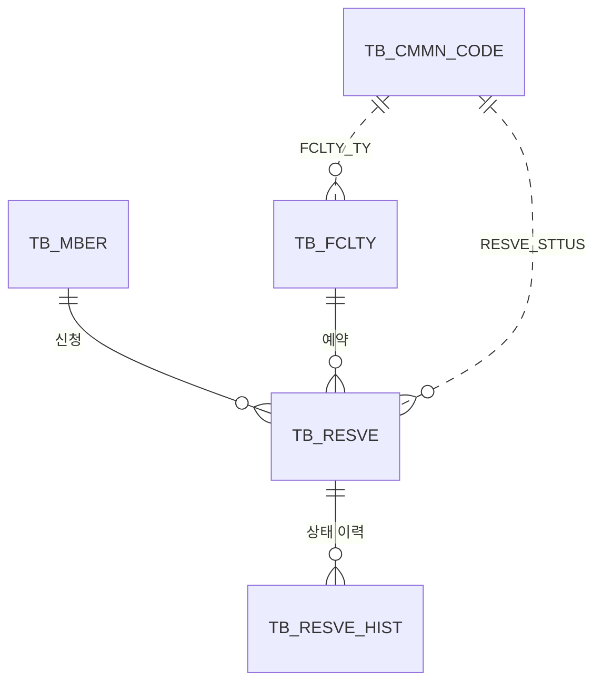

# 공공시설 예약 시스템

전자정부 표준프레임워크 4.3 실행환경으로 만든 공공시설(체육관·회의실·강당·운동장) 예약 시스템입니다.
시민이 예약을 신청하면 관리자가 승인·반려하고, 모든 상태 변경은 이력으로 남습니다.

- **개발 인원:** 1인
- **기술:** Java 17 · 전자정부 표준프레임워크 4.3 (Spring MVC 5.3) · MyBatis · Oracle 21c XE · JSP/JSTL · Tomcat 9
- **다룬 문제:** 동시 신청 경합(같은 시간대 중복, 1인 일일 한도 우회), 커넥션 풀 교착, 시큐어코딩 적용
- **화면:** 범정부 UI/UX 디자인 시스템(KRDS) 참고, 웹 접근성 항목 점검

---

## 기능

| 구분 | 화면 | 내용 |
| --- | --- | --- |
| 시민 | 회원가입·로그인 | BCrypt 비밀번호, 로그인 시 세션 재발급 |
| | 메인 | 유형별 시설 수, 다가오는 나의 예약, 공지 |
| | 시설 찾기 | 유형·시설명 검색, 페이징 (표준프레임워크 `PaginationInfo`) |
| | 시설 상세 | 날짜별 예약 가능 시간표, 시간표를 눌러 시간 선택(연속된 빈 칸만 범위 선택), 예약 신청 |
| | 나의 예약 | 상태별 조회, 상세·처리 이력, 취소 (이용일 전날까지) |
| | 공지사항 | 목록·상세 |
| 관리자 | 대시보드 | 승인 대기, 오늘 이용 예정, 최근 7일 신청, 이번 달 반려율(이력 기준 집계), 먼저 처리할 신청 |
| | 예약 관리 | 시설·상태·기간·신청자 검색, 승인, 반려(사유 필수), 처리 이력 |
| | 시설 관리 | 등록·수정·사용 중지 (운영시간, 예약 단위 30·60·120분) |
| | 공지 관리 | 등록·수정·삭제(논리 삭제) |

**예약 규칙:** 내일부터 30일 이내 · 운영시간 안에서 예약 단위에 맞춰 · 수용 인원 이하 · 같은 시설의 신청·승인 예약과 시간이 겹치면 안 됨 · **1인 1일 최대 2시간** (시설 합산)



---

## 구조

전자정부 표준프레임워크의 계층 규칙을 따릅니다.

```
egovframework
├─ cmm      공통: 로그인 VO, 인증·CSRF 인터셉터, 공통코드, 페이징
├─ mber     회원
├─ fclty    시설
├─ resve    예약
└─ notice   공지
   ├─ service        인터페이스, VO
   ├─ service.impl   *ServiceImpl (EgovAbstractServiceImpl 상속), *Mapper (@Mapper)
   └─ web            Controller
```

- 트랜잭션: `context-transaction.xml`에서 `*Impl` 메서드 단위로 AOP 적용
- 예외: 업무 예외는 `processException("메시지키")` → 표준 `ExceptionTransfer`가 받아서 처리기에 넘기고, 화면에는 메시지만 표시
- 업무 규칙 값(30일, 2시간, 페이지 크기): `EgovPropertyService`로 관리
- 컬럼명: 공공데이터 공통표준용어 약어 (`RESVE_DE` 예약일자, `FCLTY_SN` 시설일련번호 …)



DDL: [`src/main/resources/db/ddl.sql`](src/main/resources/db/ddl.sql)

---

## 1. 동시 신청 경합

### 문제

"겹치는 예약이 있는지 조회 → 없으면 INSERT"는 동시에 들어온 요청이 같은 조회 결과(0건)를 보고 함께 INSERT할 수 있습니다. 경합은 두 종류입니다.

| 경합 | 상황 | 깨지는 규칙 |
| --- | --- | --- |
| ① 같은 시간대 | 여러 사람이 같은 시설·같은 시간에 동시 신청 | 중복 예약 |
| ② 1인 일일 한도 | 한 사람이 **서로 다른 시설**에 동시 신청 | 하루 2시간 제한 우회 |

②는 시설이 서로 달라서 시설 단위 잠금으로는 막을 수 없습니다.

### 해결

신청 트랜잭션 안에서 검사하기 전에 행을 잠가 같은 대상의 신청을 한 줄로 세웁니다 ([`ResveServiceImpl.insertResve`](src/main/java/egovframework/resve/service/impl/ResveServiceImpl.java)).

```
① SELECT ... FROM TB_MBER  WHERE MBER_ID  = ? FOR UPDATE   -- 같은 회원의 신청 직렬화 (경합②)
② SELECT ... FROM TB_FCLTY WHERE FCLTY_SN = ? FOR UPDATE   -- 같은 시설의 신청 직렬화 (경합①)
③ 시간 겹침 검사 → ④ 일일 사용 시간 합산 검사 → INSERT + 이력
```

- **잠금 순서를 회원 → 시설로 고정**해 두 요청이 서로의 잠금을 기다리는 교착(deadlock)을 막습니다.
- 서로 다른 사람이 서로 다른 시설에 신청하면 잠금이 겹치지 않아 동시에 처리됩니다 (테스트로 확인).
- 승인·반려·취소는 `UPDATE ... WHERE RESVE_STTUS_CD = 이전상태`로 바꾸고, 0건이면 "이미 처리된 예약"으로 처리합니다. 관리자 승인과 시민 취소가 동시에 일어나도 한쪽만 반영됩니다.

### 결과

같은 조건에서 구현별로 10회씩 실행했습니다. (Oracle 21c XE 로컬, 커넥션 풀 최대 20, 2026-11-21)

| 구현 | 경합① 100명이 같은 시간 신청 (정답 1건) | 경합② 1명이 시설 10곳에 1시간씩 (정답 2건) |
| --- | --- | --- |
| 잠금 없음 (조회 후 INSERT) | **4~20건 성공** (평균 13.7) | **7~10건 성공** (평균 9.2) |
| 잠금 + 별도 커넥션 채번 | 1건, 단 80명은 5초 대기 후 시스템 오류 | 2건 |
| **잠금 + 같은 커넥션 채번 (현재)** | **1건**, 나머지 99명은 "이미 예약된 시간" 안내 (약 50ms) | **2건** |

잠금이 없으면 한 시간대에 최대 20건이 겹쳐 들어갔고, 한 사람이 하루 10시간까지 예약했습니다.
원본 기록: [`docs/bench/2026-11-21-race.txt`](docs/bench/2026-11-21-race.txt), 측정 코드: [`ResveRaceBench`](src/test/java/egovframework/resve/ResveRaceBench.java)

---

## 2. 커넥션 풀 교착: 표준 ID 생성 서비스

### 문제

처음에는 예약번호를 표준프레임워크 ID 생성 서비스(`EgovSequenceIdGnrServiceImpl`)로 받았습니다. 동시성 테스트를 돌리자 **테스트가 10분 넘게 끝나지 않았습니다.**

스레드 덤프를 보니 모든 스레드가 커넥션 풀에서 커넥션을 기다리고 있었습니다. 원인은 이렇습니다.

1. ID 생성 서비스는 현재 트랜잭션의 커넥션이 아니라 `dataSource.getConnection()`으로 **커넥션을 새로 하나 더** 받습니다.
2. 요청 20개가 트랜잭션 커넥션을 하나씩 잡고, 그중 19개는 행 잠금을 기다립니다.
3. 잠금을 가진 1개는 채번용 커넥션이 필요한데 풀(최대 20)이 비어 있습니다.
4. 잠금을 가진 요청은 커넥션을, 나머지는 잠금을 기다리며 **전체가 멈춥니다.**

### 해결

- 예약번호를 MyBatis `selectKey`로 **같은 커넥션에서** 시퀀스(`SEQ_RESVE.NEXTVAL`)로 읽습니다. 요청 하나가 커넥션을 하나만 씁니다.
- 커넥션 대기 시간을 5초(`maxWaitMillis`)로 제한했습니다. 같은 문제가 다시 생겨도 무한 대기 대신 오류로 드러납니다.

수정 전 코드는 커밋 `b7d2b1e`, 수정은 `d88252f`입니다. 위 결과표의 "잠금 + 별도 커넥션 채번"이 수정 전 방식입니다 (대기 제한 5초를 건 상태에서 측정).

---

## 3. 시큐어코딩 적용

행정안전부 SW 보안약점 진단 항목 중 이 서비스에 해당하는 것을 적용했습니다.

| 보안약점 | 적용 | 확인 |
| --- | --- | --- |
| SQL 삽입 | 모든 쿼리 `#{}` 바인딩, `${}` 미사용 | 매퍼 전수 |
| 크로스사이트 스크립트 | 출력 시점 `<c:out>` 이스케이프. 입력 필터(HTMLTagFilter)는 저장 데이터를 바꿔 이중 이스케이프를 만들어 쓰지 않음 | `<script>`가 든 사용목적이 `&lt;script&gt;`로 출력되는 것 확인 |
| 크로스사이트 요청 위조 | 세션별 난수 토큰, 상태 변경은 POST + 토큰 일치 시에만 처리 | `SecurityInterceptorTest` |
| 부적절한 인가 | `/admin/**` 관리자, `/resve/**` 로그인 (인터셉터). 예약 조회·취소는 **서비스에서 본인 여부를 한 번 더** 확인 (예약번호만 바꾸는 접근 차단) | `ResveRuleTest.ownershipCheck` |
| 파라미터 변조 | 신청자·상태·등록자는 `@InitBinder`로 바인딩 금지, 세션 값으로만 채움 | `mberId=admin`을 함께 보내도 신청자는 본인으로 저장되는 것 확인 |
| 취약한 비밀번호 저장 | BCrypt. 없는 아이디도 해시 비교를 해 응답 시간으로 아이디 존재를 알 수 없게 함 | |
| 세션 고정 | 로그인 성공 시 기존 세션 폐기 후 새로 발급, 쿠키 HttpOnly, URL 세션 ID 금지 | |
| 오류 메시지 정보 노출 | 오류 화면에 스택 트레이스 없음, 업무 예외는 메시지만 | |
| 중요 정보 노출 | DB 접속 정보는 Git 제외 파일(`db.properties`) | `.gitignore` |

---

## 4. 화면: KRDS 참고와 웹 접근성

공공 누리집처럼 보이도록 **범정부 UI/UX 디자인 시스템(KRDS)** 표준형 스타일을 참고했습니다. KRDS 준수 인증이 아니라 참고 구현입니다.

- 색상: KRDS 공식 저장소의 토큰 파일(`krds_tokens.css`) light 팔레트 값 사용 (primary-50 `#256EF4` 등)
- 글꼴: Pretendard GOV, 본문 17px, 줄 간격 150%
- 상태 배지: KRDS 시스템 색상 규칙(배경 5단계, 테두리 10단계, 글자 60단계)
- 실제 정부 누리집으로 오인되지 않도록 공식 누리집 표시 배너와 정부 상징은 쓰지 않고, 상단에 "포트폴리오용 데모" 문구를 둠

웹 접근성(KWCAG) 항목 중 이 화면에 해당하는 것을 점검했습니다.

| 항목 | 적용 |
| --- | --- |
| 건너뛰기 링크 | 첫 Tab에 "본문 바로가기" |
| 제목 | 페이지마다 `<title>`과 `<h1>` 1개, 현재 위치(breadcrumb) |
| 레이블 | 모든 입력 요소에 `<label for>`, 형식 안내는 `aria-describedby` |
| 표 | `<caption>`, `<th scope>` |
| 현재 메뉴·페이지 | `aria-current="page"` |
| 키보드 초점 | 모든 링크·버튼·입력에 보이는 초점 표시 |
| 대체 텍스트 | 템플릿의 이미지 페이징 버튼(대체 텍스트 없음)을 텍스트 링크 + `aria-label`로 교체 (`TextPaginationRenderer`) |
| 사용자 요구에 따른 실행 | 날짜를 바꿔도 바로 이동하지 않고 [조회]를 눌러야 바뀜 |
| 상태 전달 | 시간표 칸은 `<button aria-pressed>`, 선택 결과는 `aria-live`로 읽힘, 오류는 `role="alert"` |
| 명도 대비 | 본문 글자는 KRDS 대비 4.5:1 이상 단계(60 이상) 사용 |

라벨 누락, 표 제목, 페이지당 `<h1>` 수는 주요 화면 10개를 스크립트로 검사했습니다. 스크린리더 실기 테스트는 하지 않았습니다.

---

## 설계 선택과 이유

| 결정 | 이유 | 고려한 대안 |
| --- | --- | --- |
| 행 잠금(`FOR UPDATE`) | 검사 규칙(겹침, 일일 합산)을 그대로 두고 순서만 직렬화. 공공시설은 시설당 동시 신청이 적어 대기가 짧음 | **시간 슬롯 UNIQUE 제약**: 겹침은 DB가 막지만 일일 한도는 못 막고, 예약 단위가 다른 시설마다 슬롯 행을 만들어야 함 · **낙관적 락(버전 컬럼)**: 충돌 시 재시도 로직이 필요하고 "아직 없는 행"의 중복은 막지 못함 |
| 회원 → 시설 잠금 순서 고정 | 두 잠금을 반대 순서로 잡는 요청 사이의 교착 방지 | |
| 상태 변경은 조건부 UPDATE | 승인·취소가 겹쳐도 한쪽만 반영, 별도 잠금 불필요 | 조회 후 상태 확인 → UPDATE (경합 발생) |
| 같은 커넥션 채번 | 위 2번의 풀 교착 | 표준 ID 생성 서비스 |
| ROWNUM 페이징 | Oracle 11g 환경에서도 그대로 동작 | `OFFSET … FETCH` (12c 이상) |

---

## 테스트

실제 Oracle에 연결해 실행합니다. 테스트 데이터는 실행 전후로 지웁니다.

| 테스트 | 수 | 내용 |
| --- | --- | --- |
| `ResveConcurrencyTest` | 4종 × 3회 | 경합①(같은 시간, 부분 겹침), 경합②(일일 한도), 서로 다른 시설은 막지 않음 |
| `ResveRuleTest` | 8 | 겹침 경계(맞닿음 허용), 날짜 범위, 운영시간·단위·정원, 일일 한도, 본인 확인, 상태 전이와 이력, 대시보드 집계 |
| `SecurityInterceptorTest` | 4 | 비로그인 차단, 관리자 경로 403, CSRF 토큰 |

```bash
./mvnw test                      # 24개
./mvnw test -Dtest=ResveRaceBench -Dsurefire.failIfNoSpecifiedTests=false   # 구현 비교 측정
```

---

## 실행 방법

1. Oracle 21c XE에 계정을 만들고 [`ddl.sql`](src/main/resources/db/ddl.sql), [`data.sql`](src/main/resources/db/data.sql)을 실행합니다. 대시보드에 보일 예약이 필요하면 [`demo-resve.sql`](src/main/resources/db/demo-resve.sql)도 실행합니다 (실행일 기준 날짜로 생성).
2. `src/main/resources/egovframework/props/db.properties.example`을 `db.properties`로 복사해 접속 정보를 넣습니다.
3. `./mvnw package`로 만든 `target/egov-facility-reservation.war`를 Tomcat 9에 배포하거나, 전자정부 개발도구(Eclipse)에서 Maven 프로젝트로 가져와 Tomcat 9 서버로 실행합니다.

**데모 계정** (로컬 데모 전용)

| 구분 | 아이디 | 비밀번호 |
| --- | --- | --- |
| 관리자 | admin | Admin1234! |
| 시민 | citizen1 | Citizen1234! |
| 시민 | citizen2 | Citizen1234! |
